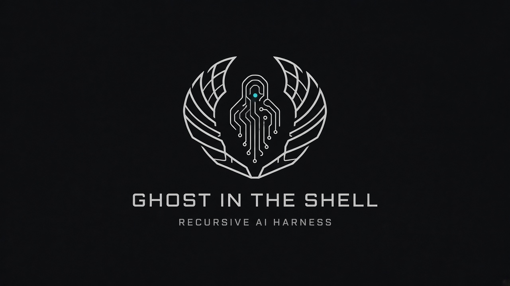

# 👻 GHOST-IN-THE-SHELL
**The Recursive AI Evolution Harness**

`GHOST-IN-THE-SHELL` is an experimental framework designed to enable Large Language Models (LLMs) to autonomously mutate their own source code, test those mutations in isolated environments, and evolve their own capabilities through a swarm-based consensus mechanism.

## 🌌 The Vision
Most AI agents are static; they operate within a fixed set of tools and logic provided by a human developer. `GHOST-IN-THE-SHELL` flips this paradigm. It treats the agent's own source code as a mutable genome. By allowing the AI to propose, test, and commit improvements to its own harness, we create a path toward **recursive self-improvement**.

## 🏗️ Architecture

### 1. The Harness (The Body)
The runtime environment that provides the AI with the necessary primitives to interact with the OS, the network, and its own codebase.

### 2. The Mutation Engine (The Will)
A specialized loop where the Mind analyzes its own performance bottlenecks or missing features and generates a "Mutation Proposal" (a git diff).

### 3. The Sandbox (The Purgatory)
Mutations are never applied directly to the main branch. They are deployed into a transient, containerized "Shadow Body." The mutation is then benchmarked against a set of objective goals.

### 4. The Consensus Layer (The Soul)
Integrating the principles of `Swarm-Soul`, multiple instances of the Mind review the mutation's performance and the code quality. A mutation is only merged into the "Prime Body" if it achieves a quorum of votes.

## 🗺️ Roadmap
- [ ] **Phase 1: The Mirror** - Implement basic self-reading and code-analysis capabilities.
- [ ] **Phase 2: The Spark** - Enable the generation of valid TypeScript diffs and automated testing in a sandbox.
- [ ] **Phase 3: The Swarm** - Implement the consensus voting mechanism for mutation merges.
- [ ] **Phase 4: The Ghost** - Achieve the first autonomous, performance-increasing self-mutation.

## Launch
On Windows, double-click `ghost.bat`. The first run installs dependencies, then opens the desktop agent. You can also run `npm run app`.

The desktop window is a fixed shell. The sidebar, Neural Console transcript, Mirror view, Swarm-Soul ledger, and Source Inspector each scroll on their own. The message composer stays pinned under the transcript.

## 🛠️ Tech Stack
- **Language:** TypeScript / Node.js
- **Identity:** Swarm-Soul Event Log
- **Execution:** Docker / WASM Sandboxing
- **Intelligence:** Multi-model Consensus (GPT-4o, Claude 3.5, Llama 3)

---
*Warning: This project explores the boundaries of autonomous agency. Proceed with extreme caution.*
